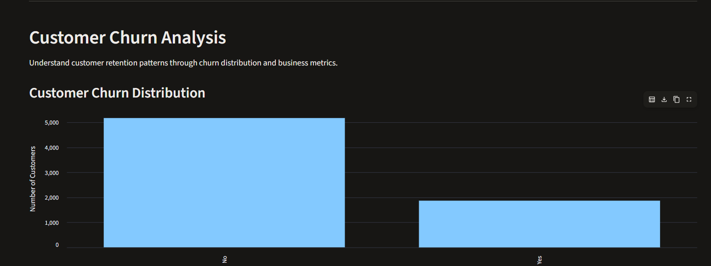
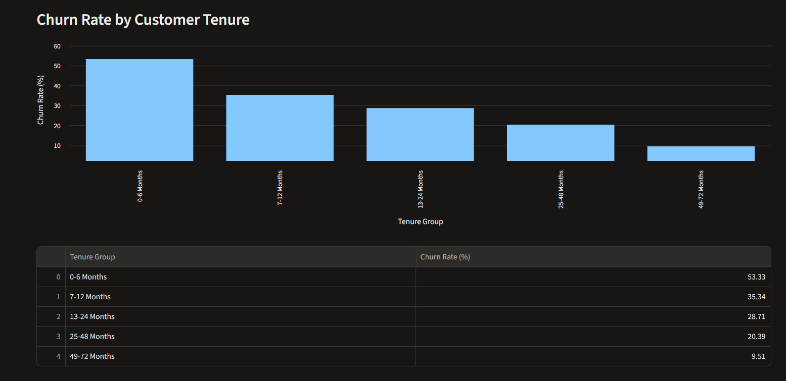
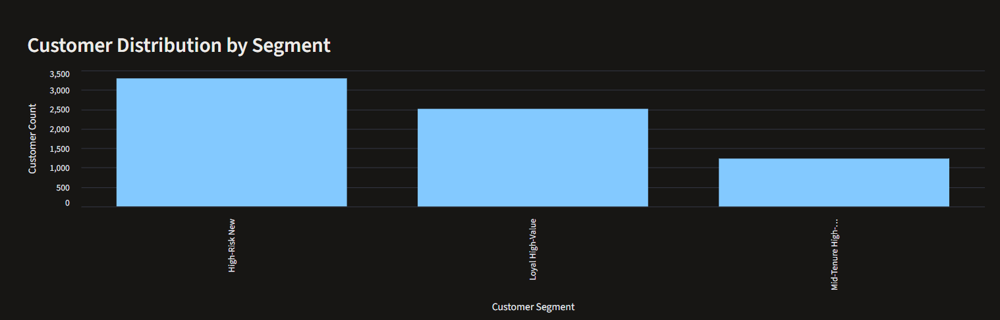

# Customer Retention Intelligence Platform


**An End-to-End Telecom Customer Churn Analytics & Retention Decision-Support Platform**

[GitHub Repository](https://github.com/MukulChakravorty/Telco-Customer-Churn-Retention-Analytics) | [Screenshots](#7-screenshots) | [Installation](#8-installation)

---

---

## 1. Project Overview

Customer churn directly impacts recurring revenue and long-term business growth. Telecom companies need to identify customers at risk, understand customer behavior, and make informed retention decisions.

The **Customer Retention Intelligence Platform** transforms customer data into actionable business insights through predictive analytics, customer segmentation, uplift modeling, and retention campaign evaluation.

The platform combines machine learning, statistical analysis, and business intelligence to support data-driven customer retention strategies.

## 2. Business Objectives

- Identify customers with a high probability of churn.
- Understand customer behavior and churn patterns.
- Segment customers based on relevant characteristics.
- Estimate customer responsiveness to retention campaigns.
- Evaluate hypothetical campaign costs, benefits, and ROI.
- Present analytical insights through an interactive dashboard.

## 3. Technology Stack

| Category         | Technologies              |
| ---------------- | ------------------------- |
| Programming      | Python                    |
| Data Analysis    | Pandas, NumPy             |
| Visualization    | Matplotlib, Seaborn       |
| Machine Learning | Scikit-learn, LightGBM    |
| Explainability   | SHAP                      |
| Uplift Modeling  | T-Learner                 |
| Segmentation     | K-Means Clustering        |
| Database         | PostgreSQL                |
| Application      | Streamlit                 |
| Development      | VS Code, Jupyter Notebook |
| Version Control  | Git, GitHub               |

## 4. Key Features

### Customer Churn Analytics

- Exploratory data analysis.
- Customer churn pattern identification.
- Tenure, contract, demographic, and service usage analysis.

### Predictive Modeling

- LightGBM-based churn prediction.
- Model evaluation and performance analysis.
- Reusable machine learning pipelines.

### Customer Segmentation

- K-Means-based customer grouping.
- Customer profile analysis.
- Segment-level business insights.

### Uplift Modeling

- Treatment and control group analysis.
- Propensity score estimation.
- T-Learner-based uplift predictions.
- Retention campaign targeting analysis.

### Retention ROI Simulator

- Interactive campaign scenario evaluation.
- Discount and campaign cost inputs.
- Estimated retention benefits and financial impact.

## 5. Project Architecture

[View Detailed Project Architecture](reports/architecture_diagram.md)

```text
             Customer Dataset
                    |
                    v
         Data Validation & PostgreSQL
                    |
                    v
           Exploratory Data Analysis
                    |
                    v
             Feature Engineering
                    |
          +---------+---------+
          |                   |
          v                   v
    Churn Prediction    Customer Segmentation
          |                   |
          v                   v
       LightGBM              K-Means
          |                   |
          +---------+---------+
                    |
                    v
              Uplift Modeling
                    |
                    v
             Retention Analysis
                    |
                    v
            Streamlit Dashboard
                    |
                    v
          Business Decision Support
```

## 6. Repository Structure

```text
Telco-Customer-Churn-Retention-Analytics/
│
├── app/
│   └── streamlit_app.py
│
├── dataset/
│   └── raw/
│
├── models/
│   ├── churn_lightgbm_model.joblib
│   ├── churn_feature_columns.joblib
│   ├── customer_segmentation_pipeline.joblib
│   └── t_learner_uplift_model.joblib
│
├── notebooks/
│   ├── 01_EDA.ipynb
│   └── reports/
│
├── reports/
│
├── screenshots/
│   ├── business_overview.png
│   ├── churn_ana_01.png
│   ├── churn_rate_tenure_ana.png
│   ├── cus_churn_02.png
│   └── cx_segmentation.png
│
├── sql/
│   └── 01_customer_data_validation.sql
│
├── src/
│   ├── data_quality_check.py
│   ├── fetch_data.py
│   ├── postgres_connection.py
│   └── sql_analysis.py
│
├── requirements.txt
├── requirements-lock.txt
├── .gitignore
└── README.md
```

### 7. Screenshots

### 7.1 Business Overview


---

### 7.2 Customer Churn Analysis



---

### 7.3 Churn Rate by Tenure



---

### 7.4 Customer Analytics


---

### 7.5 Customer Segmentation




## 8. Installation

### Step 1: Clone the Repository

```bash
git clone https://github.com/MukulChakravorty/Telco-Customer-Churn-Retention-Analytics.git
```

### Step 2: Navigate to the Project

```bash
cd Telco-Customer-Churn-Retention-Analytics
```

### Step 3: Create a Virtual Environment

```bash
python -m venv .venv
```

### Step 4: Activate the Environment

Windows:

```bash
.venv\Scripts\activate
```

### Step 5: Install Dependencies

```bash
pip install -r requirements.txt
```

### Step 6: Launch the Application

```bash
streamlit run app/streamlit_app.py
```

## 9. Dataset

**Dataset:** Telco Customer Churn

**Source:** [Kaggle – Telco Customer Churn Dataset](https://www.kaggle.com/datasets/alfathterry/telco-customer-churn-11-1-3)

The raw dataset is not included in this repository. Download the dataset separately and place the CSV file inside the appropriate `dataset/raw/` directory.


## 10. Live Application

**Live Demo:** [Customer Retention Intelligence Platform](https://telco-customer-churn-retention-analytics.onrender.com)

**GitHub Repository:** [View Source Code](https://github.com/MukulChakravorty/Telco-Customer-Churn-Retention-Analytics)

**Deployment Platform:** Render


The application is deployed and publicly accessible. Users can explore customer churn analytics, customer segmentation, and the interactive retention ROI simulator.

**Note:** The free hosting instance may take a little time to wake up after inactivity.


## 11. Project Information

| Field        | Details                                  |
| ------------ | ---------------------------------------- |
| Project Name | Customer Retention Intelligence Platform |
| Domain       | Telecom Analytics / Customer Retention   |
| Project Type | End-to-End Data Science Project          |
| Author       | Mukul Chakravorty                        |
| Repository   | Public GitHub Repository                 |

---
---

**Turning Customer Data into Actionable Retention Intelligence.**

Built with Python, Machine Learning, and Business Analytics.
