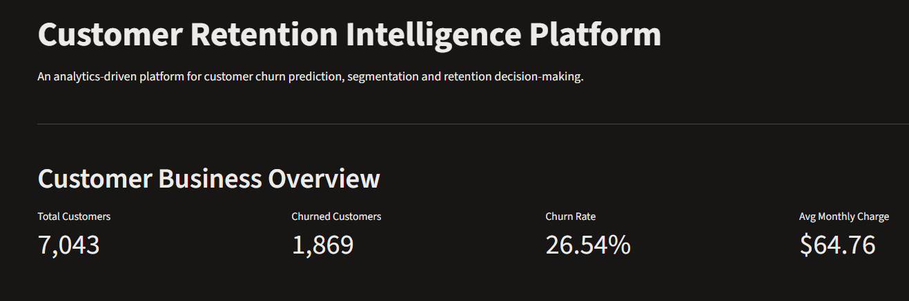
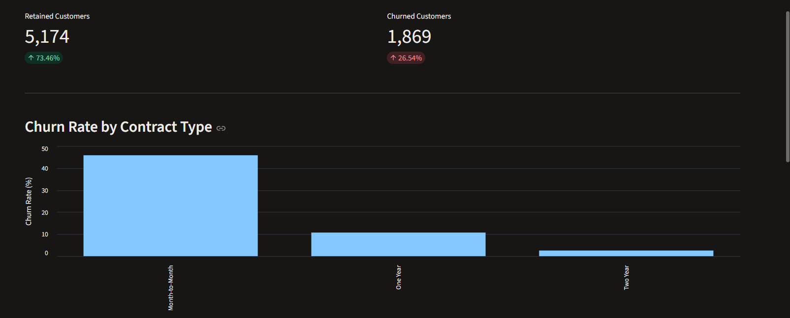

# Customer Retention Intelligence Platform

An end-to-end Telecom Customer Churn Analytics and Retention Decision-Support Platform built using Python, LightGBM, Machine Learning, Customer Segmentation, and Streamlit.

The platform transforms customer data into actionable business insights by identifying churn patterns, predicting customer churn risk, exploring customer segments, and evaluating hypothetical retention campaign scenarios.

---

## 1. Business Problem

Customer churn directly impacts recurring revenue and long-term business growth. Telecom companies need to understand why customers leave, identify customers at risk, and make informed retention decisions.

This project addresses these challenges through an integrated analytics platform combining exploratory data analysis, predictive modeling, customer segmentation, and financial scenario analysis.

## 2. Project Objectives

- Analyze customer behavior and identify churn patterns.
- Identify customer segments associated with higher churn.
- Develop a machine learning model to predict customer churn.
- Evaluate model performance using classification metrics.
- Explore model interpretability and customer-level treatment-effect predictions.
- Perform customer segmentation using KMeans clustering.
- Estimate the financial impact of hypothetical retention campaigns.

## 3. Technology Stack

| Category | Technologies |
|---|---|
| Programming | Python |
| Data Analysis | Pandas, NumPy |
| Visualization | Matplotlib, Seaborn |
| Machine Learning | Scikit-learn, LightGBM |
| Model Explainability | SHAP |
| Uplift Modeling | CausalML |
| Customer Segmentation | KMeans |
| Application | Streamlit |
| Model Persistence | Joblib |
| Development | VS Code, Jupyter Notebook |

## 4. Solution Architecture

The project follows an analytical workflow:

1. Customer Dataset
2. Data Quality Assessment
3. Exploratory Data Analysis
4. Feature Engineering and Preprocessing
5. LightGBM Churn Prediction
6. Model Evaluation and Explainability
7. Uplift Modeling and Evaluation
8. Customer Segmentation
9. Interactive Streamlit Application
10. Retention ROI Scenario Analysis

## 5. Key Project Modules

### A. Exploratory Data Analysis

- Customer churn distribution
- Demographic analysis
- Contract-based churn analysis
- Customer tenure analysis
- Customer behavior exploration
- Business insight generation

### B. Churn Prediction

- LightGBM classification
- Churn probability estimation
- Customer-level churn predictions
- Classification performance evaluation
- Model artifact persistence

### C. Survival Analysis

- Customer retention duration analysis
- Time-to-event analysis
- Customer survival patterns

### D. Uplift Modeling

- T-Learner treatment-effect modeling
- Individual uplift predictions
- Uplift decile analysis
- AUUC and Qini evaluation

**Important:** Uplift results are experimental. The current evaluation indicates that further validation is necessary before using predictions for real-world retention campaign targeting.

### E. Customer Segmentation

- KMeans clustering
- Customer segment identification
- Segment distribution analysis
- Customer segment profiling

### F. Retention ROI Simulator

An interactive Streamlit module that allows users to explore hypothetical retention campaign scenarios.

Configurable assumptions include:

- Number of customers targeted
- Discount percentage
- Discount duration
- Assumed retention success rate
- Revenue projection period
- Campaign contact cost

Financial outputs include:

- Expected customers retained
- Estimated revenue preserved
- Total campaign cost
- Net financial benefit
- Estimated campaign ROI

**Note:** The ROI simulator uses user-defined assumptions and average monthly charges. It provides illustrative gross-revenue estimates, not guaranteed financial returns or validated causal uplift estimates.

## 6. Dataset Overview

The project uses a telecom customer churn dataset containing 7,043 customer records.

| Metric | Value |
|---|---:|
| Total Customers | 7,043 |
| Churned Customers | 1,869 |
| Retained Customers | 5,174 |
| Overall Churn Rate | 26.54% |

## 7. Key Business Insights

The exploratory analysis identified several important churn patterns.

| Customer Segment | Churn Rate |
|---|---:|
| Month-to-Month Contract | 45.84% |
| One-Year Contract | 10.71% |
| Two-Year Contract | 2.55% |
| 0–6 Months Tenure | 53.33% |
| 7–12 Months Tenure | 35.34% |
| 13–24 Months Tenure | 28.71% |
| 25–48 Months Tenure | 20.39% |
| 49–72 Months Tenure | 9.51% |

### Business Interpretation

- Month-to-month customers exhibit substantially higher churn than customers with longer-term contracts.
- Customers in their first six months have the highest observed churn rate.
- Longer customer tenure is associated with lower churn.
- Early customer engagement and contract-based retention strategies are important areas for further investigation.

These observations represent associations in the dataset and do not establish causation.

## 8. Streamlit Application

The application provides four interactive modules:

1. **Business Overview** – Customer statistics and dataset overview.
2. **Churn Analysis** – Churn distribution and customer retention patterns.
3. **Customer Segmentation** – KMeans-based customer segment exploration.
4. **Retention ROI Simulator** – Hypothetical retention campaign financial analysis.

### Application Screenshots

#### 1. Business Overview


#### 2. Customer Churn Analysis


#### 3. Churn Rate by Tenure


#### 4. Customer Churn Insights


#### 5. Customer Segmentation


## 9. Project Structure

```text
DS-01_Telco_Customer_Churn/
│
├── app/
│   └── streamlit_app.py
│
├── dataset/
│   └── raw/
│
├── models/
│   ├── churn_lightgbm_model.joblib
│   ├── churn_feature_columns.joblib
│   ├── customer_segmentation_pipeline.joblib
│   └── t_learner_uplift_model.joblib
│
├── notebooks/
│   └── 01_EDA.ipynb
│
├── reports/
│   ├── customer_segments.csv
│   ├── customer_uplift_predictions.csv
│   └── uplift_evaluation_metrics.csv
│
├── screenshots/
│
├── sql/
│
├── src/
│   └── data_quality_check.py
│
├── .gitignore
├── README.md
├── requirements.txt
└── requirements-lock.txt
```

## 10. Installation and Execution

### Prerequisites

- Python 3.12
- Git
- Visual Studio Code (recommended)

### Step 1: Clone the Repository

```bash
git clone YOUR_GITHUB_REPOSITORY_URL

cd DS-01_Telco_Customer_Churn
```

### Step 2: Create a Virtual Environment

```bash
python -m venv .venv
```

Activate it on Windows:

```bash
.venv\Scripts\activate
```

### Step 3: Install Dependencies

```bash
pip install -r requirements.txt
```

### Step 4: Run the Application

```bash
streamlit run app/streamlit_app.py
```

The application will open in your default browser.

## 11. Model and Business Limitations

- Predictive performance should be assessed using multiple classification metrics rather than accuracy alone.
- Uplift predictions require stronger validation and, ideally, randomized treatment-control experiments.
- ROI outputs depend on configurable assumptions and should not be interpreted as actual campaign performance.
- Model predictions should support, not replace, business judgment.

## 12. Future Improvements

- Improve model calibration and threshold optimization.
- Strengthen uplift model validation.
- Integrate a production database.
- Add automated model monitoring.
- Enhance customer-level retention recommendations.
- Deploy the application to a cloud platform.

## 13. Project Information

**Project Name:** Customer Retention Intelligence Platform
**Domain:** Telecom Analytics / Customer Retention
**Project Type:** End-to-End Data Science Project
**Author:** Mukul Chakravorty

---

*Built as part of a practical Data Science capstone project focused on transforming customer analytics into business-oriented decision support.*
