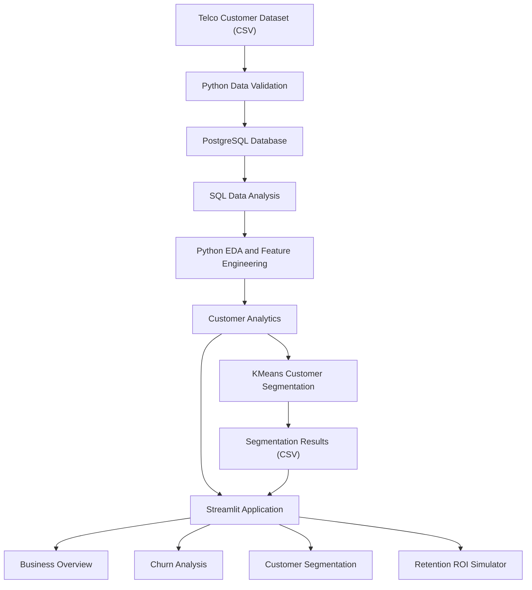

# Project Architecture

## Customer Retention Intelligence Platform

This diagram illustrates the end-to-end workflow, from raw customer data processing to business intelligence and retention decision support.

